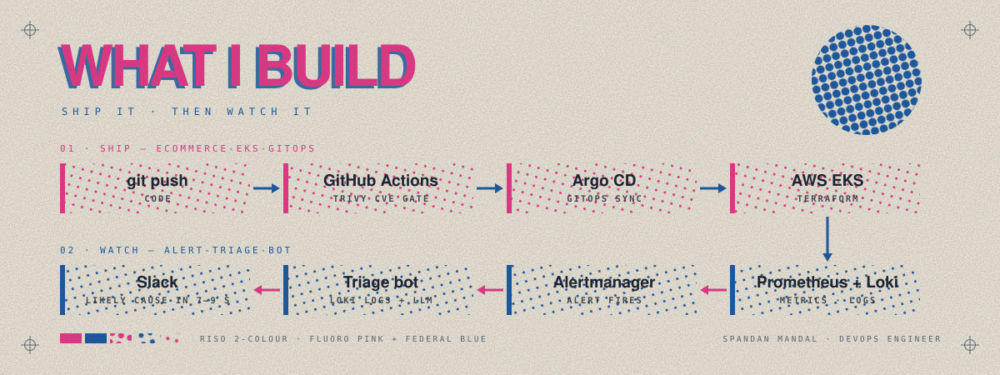

<h2 align="center">Spandan Mandal · DevOps Engineer</h2>

  
  
  

  <picture>
    <source media="(prefers-color-scheme: dark)" srcset="assets/stack-dark.svg">
    
  </picture>

  

### Impact at Questalious (2024–2026)

  
  
  
  

### Projects

| Project | What it does |
|---|---|
| [**alert-triage-bot**](https://gitlab.com/spandanmandal/alert-triage-bot) | Alert → error logs + LLM's likely cause in Slack, 7–9 s |
| [**ecommerce-eks-gitops**](https://github.com/spandanmandal1/ecommerce-eks-gitops) | 19-service app on EKS, GitOps deploys, CVE-gated CI |

  
  

